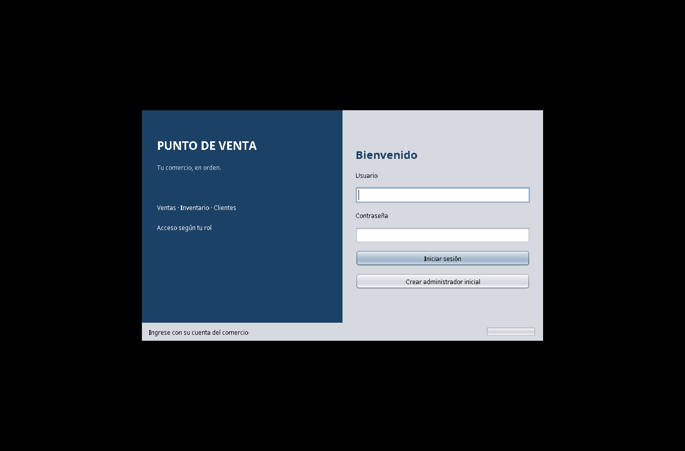
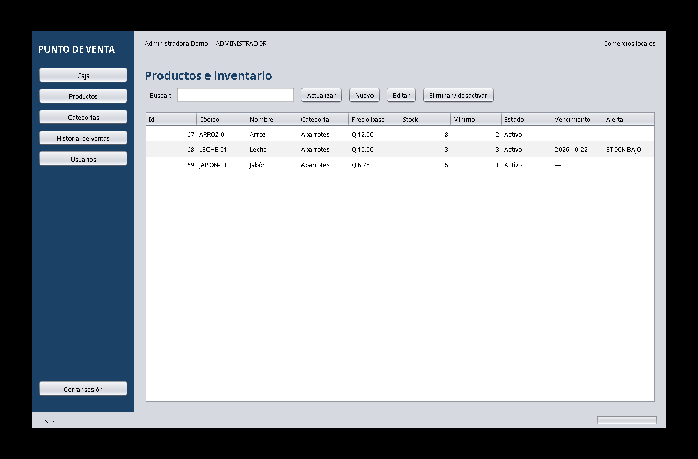
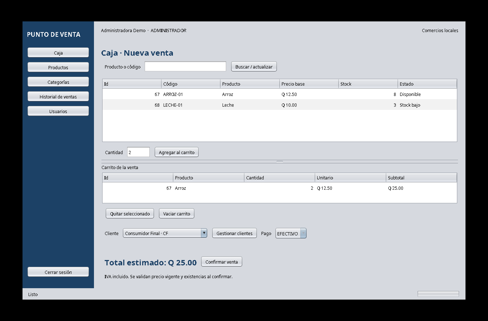
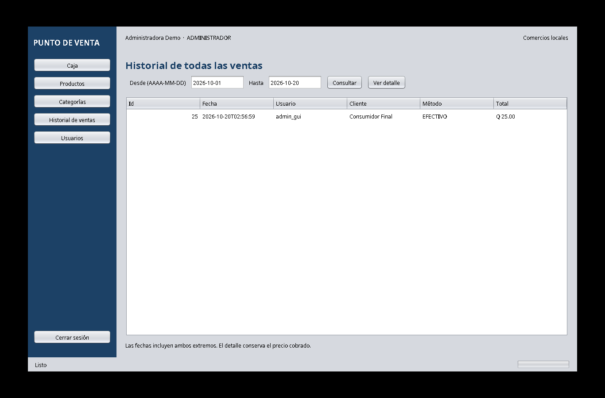

\clearpage

# Entrega y criterios solicitados

Este documento reúne los materiales de apoyo para revisar la Fase 2 del Sistema de Punto de Venta para Comercios Locales. No se incluye video; se agregan capturas de pantalla como evidencia visual.

| Criterio | Material / evidencia |
|---|---|
| Proyecto NetBeans y código fuente | Proyecto Maven completo incluido junto a este PDF como `proyecto-netbeans-fase2.zip`; extraerlo y abrir `pom.xml` desde NetBeans 31. |
| Script SQL con tablas, PK, FK y restricciones | Anexo A de este PDF y `sql/01_schema.sql`. |
| Instrucciones para ejecutar (máximo 1 página) | Sección 2 de este documento. No contiene contraseñas reales. |
| Evidencia de funcionamiento | Capturas de Login, Productos, Caja e Historial en la sección 3. |
| CRUD con MySQL | Código DAO y pruebas de integración `MySqlTest`; resultados registrados en `docs/fase2/validacion.md`. |
| PreparedStatement | Los valores de las consultas JDBC se envían como parámetros desde la capa DAO. |
| Validación y secretos | Validaciones en modelos/controladores; conexión mediante variables de entorno y credenciales fuera del repositorio. |

Las capturas muestran ventanas de la aplicación Swing conectada a MySQL; Swing es la interfaz incorporada en Fase 3. Complementan la evidencia de pruebas CRUD de Fase 2. No muestran por sí solas cada operación INSERT, UPDATE y DELETE.

# 2. Instrucciones de ejecución (una página)

**Requisitos:** Apache NetBeans 31, JDK completo 21 o superior (compilación release 21), Maven 3.9 o superior y servidor MySQL 8.0.16 o superior. Las pruebas documentadas se ejecutaron con MySQL Community Server 8.4.11. En Workbench, confirma el servidor con `SELECT VERSION();`.

**Preparar la base:** en MySQL Workbench abre `sql/01_schema.sql`, selecciona o crea una base vacía llamada `pos_dev` y ejecuta el script una sola vez. El SQL crea seis tablas y el registro Consumidor Final. No lo ejecutes sobre una base con datos que quieras conservar.

**Configurar conexión:** crea un usuario de MySQL local con permisos sobre `pos_dev` y configura `POS_DB_URL`, `POS_DB_USER` y `POS_DB_PASSWORD` en el entorno que inicia NetBeans. Ejemplo de URL local: `jdbc:mysql://127.0.0.1:3306/pos_dev`. No pegues contraseñas reales en este PDF, en el código ni en capturas. La cuenta de MySQL no es la cuenta de inicio de sesión del POS.

**Abrir y ejecutar:** en NetBeans usa Archivo → Abrir proyecto y selecciona la carpeta que contiene `pom.xml`. Elige el JDK y ejecuta Clean and Build. Para la consola de Fase 2 ejecuta `src/main/java/com/progra/pos/view/ConsolaApp.java` o el objetivo Maven `compile exec:java -Dpos.mainClass=com.progra.pos.view.ConsolaApp`. En la aplicación gráfica, usa el botón Crear administrador inicial solo si la tabla `usuarios` está vacía; crea una contraseña propia de al menos 8 caracteres.

**Comprobar:** inicia sesión y realiza altas, consultas, ediciones y eliminaciones desde los comandos o pantallas disponibles. Consulta nuevamente los datos en la aplicación o en Workbench para comprobar persistencia. Las pruebas de integración requieren una base de pruebas separada; consulta `docs/fase2/validacion.md`. No uses `pos_dev` para ejecutar pruebas que limpian datos.

# 3. Capturas de pantalla

Las siguientes capturas se entregan en lugar del video. Muestran la aplicación ejecutada, módulos y datos obtenidos de la base de desarrollo. Las operaciones CRUD contra MySQL se documentan además en los resultados de pruebas automatizadas de la Fase 2.



\clearpage



\clearpage



\clearpage



\clearpage

# 4. Validación registrada

La validación existente reporta compilación correcta y pruebas del modelo y MySQL. Las pruebas MySQL ejercitan CRUD, restricciones de unicidad y claves foráneas, autenticación, permisos, precios históricos, rollback y concurrencia. En la evidencia registrada de la Fase 2 se reportan 8 pruebas de modelo y 12 pruebas MySQL sin fallos. La validación completa y sus límites se encuentran en `docs/fase2/validacion.md`.

**Alcance:** las capturas disponibles son de la interfaz Swing posterior y no una grabación de video. Las credenciales mostradas son nombres de usuario de demostración; no se muestran contraseñas ni credenciales de conexión.

# Anexo A — Script SQL

Ejecutar sobre la base vacía `pos_dev`. Crea usuarios, categorías, productos, clientes, ventas y detalle de ventas, con claves primarias, claves foráneas, restricciones e índices.

```sql
-- MySQL 8.4 (CHECK también exige MySQL >= 8.0.16). Ejecutar en una BD vacía.
CREATE TABLE usuarios (
 id_usuario INT AUTO_INCREMENT PRIMARY KEY,
 nombre VARCHAR(100) NOT NULL,
 username VARCHAR(50) NOT NULL UNIQUE,
 password_hash VARCHAR(100) NOT NULL,
 activo BOOLEAN NOT NULL DEFAULT TRUE,
 rol VARCHAR(20) NOT NULL,
 CONSTRAINT ck_usuario_rol CHECK (rol IN ('ADMINISTRADOR','CAJERO'))
) ENGINE=InnoDB;
CREATE TABLE categorias (
 id_categoria INT AUTO_INCREMENT PRIMARY KEY,
 nombre VARCHAR(100) NOT NULL UNIQUE,
 descripcion VARCHAR(255) NOT NULL DEFAULT ''
) ENGINE=InnoDB;
CREATE TABLE productos (
 id_producto INT AUTO_INCREMENT PRIMARY KEY,
 codigo VARCHAR(50) NOT NULL UNIQUE,
 nombre VARCHAR(100) NOT NULL,
 precio DECIMAL(12,2) NOT NULL,
 stock INT NOT NULL,
 stock_minimo INT NOT NULL DEFAULT 0,
 activo BOOLEAN NOT NULL DEFAULT TRUE,
 categoria_id INT NOT NULL,
 tipo VARCHAR(25) NOT NULL,
 fecha_vencimiento DATE NULL,
 CONSTRAINT ck_producto_precio CHECK (precio > 0),
 CONSTRAINT ck_producto_stock CHECK (stock >= 0 AND stock_minimo >= 0),
 CONSTRAINT ck_producto_tipo CHECK (
   (tipo = 'PERECEDERO' AND fecha_vencimiento IS NOT NULL) OR
   (tipo = 'NO_PERECEDERO' AND fecha_vencimiento IS NULL)),
 CONSTRAINT fk_producto_categoria FOREIGN KEY (categoria_id) REFERENCES categorias(id_categoria) ON DELETE RESTRICT ON UPDATE RESTRICT
) ENGINE=InnoDB;
CREATE TABLE clientes (
 id_cliente INT AUTO_INCREMENT PRIMARY KEY,
 nombre VARCHAR(100) NOT NULL,
 nit VARCHAR(20) NOT NULL UNIQUE,
 telefono VARCHAR(25) NOT NULL DEFAULT ''
) ENGINE=InnoDB;
CREATE TABLE ventas (
 id_venta INT AUTO_INCREMENT PRIMARY KEY,
 fecha DATETIME NOT NULL,
 usuario_id INT NOT NULL,
 cliente_id INT NOT NULL,
 metodo_pago VARCHAR(10) NOT NULL,
 total DECIMAL(12,2) NOT NULL,
 CONSTRAINT ck_venta_total CHECK (total > 0),
 CONSTRAINT ck_venta_pago CHECK (metodo_pago IN ('EFECTIVO','TARJETA')),
 CONSTRAINT fk_venta_usuario FOREIGN KEY (usuario_id) REFERENCES usuarios(id_usuario) ON DELETE RESTRICT ON UPDATE RESTRICT,
 CONSTRAINT fk_venta_cliente FOREIGN KEY (cliente_id) REFERENCES clientes(id_cliente) ON DELETE RESTRICT ON UPDATE RESTRICT,
 INDEX ix_venta_fecha (fecha),
 INDEX ix_venta_usuario_fecha (usuario_id, fecha)
) ENGINE=InnoDB;
CREATE TABLE detalle_ventas (
 id_detalle_venta INT AUTO_INCREMENT PRIMARY KEY,
 venta_id INT NOT NULL,
 producto_id INT NOT NULL,
 cantidad INT NOT NULL,
 precio_unitario DECIMAL(12,2) NOT NULL,
 subtotal DECIMAL(12,2) NOT NULL,
 CONSTRAINT ck_detalle_cantidad CHECK (cantidad > 0),
 CONSTRAINT ck_detalle_precio CHECK (precio_unitario > 0),
 CONSTRAINT ck_detalle_subtotal CHECK (subtotal = cantidad * precio_unitario),
 CONSTRAINT uq_detalle_producto UNIQUE (venta_id, producto_id),
 CONSTRAINT fk_detalle_venta FOREIGN KEY (venta_id) REFERENCES ventas(id_venta) ON DELETE RESTRICT ON UPDATE RESTRICT,
 CONSTRAINT fk_detalle_producto FOREIGN KEY (producto_id) REFERENCES productos(id_producto) ON DELETE RESTRICT ON UPDATE RESTRICT
) ENGINE=InnoDB;
INSERT INTO clientes (nombre, nit, telefono) VALUES ('Consumidor Final', 'CF', '');
-- No se incluyen contraseñas compartidas: crear administrador con ConsolaApp --crear-admin.
```
