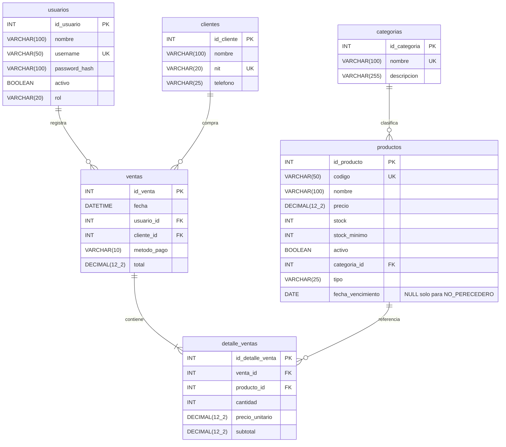

# Modelo entidad-relación
Las propiedades Java camelCase se traducen a columnas snake_case. Usuario.usuarioId no existe: la PK Java es `idUsuario`; `Venta.usuario` se representa con `ventas.usuario_id`. Las dos jerarquías usan una tabla por jerarquía: `usuarios.rol` y `productos.tipo` discriminan la subclase al leer JDBC.

En el diagrama, `DECIMAL(12_2)` representa `DECIMAL(12,2)` del SQL: doce dígitos, dos de ellos decimales. Todas las columnas son NOT NULL excepto fecha_vencimiento. Las descripciones y teléfonos admiten cadena vacía.

## Integridad y acciones referenciales
- Todas las tablas usan InnoDB para soportar transacciones y bloqueos por fila.
- Todas las FK tienen ON DELETE RESTRICT y ON UPDATE RESTRICT. Las PK son identidades internas que no se editan; no se propagan cambios ni borrados del historial.
- Categoria con productos: no se elimina. Producto con detalles: el DAO desactiva. Usuario con ventas: el DAO desactiva. Cliente con ventas: la FK impide borrar.
- UNIQUE: username, nombre de categoría, código, NIT y pareja (venta_id, producto_id). El carrito agrupa líneas del mismo producto.
- CHECK: precios positivos; stock y mínimo no negativos; cantidad positiva; subtotal correcto; rol, método y tipo válidos; vencimiento obligatorio exclusivamente para perecederos.
- El SQL no garantiza por sí solo que una venta tenga detalles ni que total sea su suma. VentaDao los guarda juntos, calcula total y rechaza carritos vacíos. El usuario de BD de la aplicación debe ser la vía controlada de escritura.
- No hay DELETE de ventas en la aplicación. Composición no equivale automáticamente a CASCADE.

## Para la defensa
**Explicación:** las clases modelan comportamiento y la BD conserva estado. Una subclase no necesita obligatoriamente una tabla propia; un discriminador permite reconstruirla sin duplicar atributos comunes.

1. **¿Cómo sabes qué subclase crear al leer productos?** ProductoDao revisa tipo; para PERECEDERO lee también fecha_vencimiento.
2. **¿Por qué RESTRICT en detalles si hay composición?** El proyecto conserva auditoría y no permite borrar ventas confirmadas; la propiedad del detalle no obliga a habilitar borrado físico.
3. **¿Un CHECK puede comprobar la suma de otra tabla?** No en este esquema MySQL. Lo garantiza la operación transaccional de VentaDao y la lectura verifica la consistencia del total.

**Cambio en vivo: agregar pago por transferencia.** 1) Agregar TRANSFERENCIA a MetodoPago. 2) Ampliar ck_venta_pago mediante una migración ALTER TABLE, no reimportar el esquema sobre datos existentes. 3) Actualizar el prompt de ConsolaApp y el E-R. 4) Guardar una venta con ese método y comprobar el historial. La cadena cabe en VARCHAR(10)? No: TRANSFERENCIA tiene 13 caracteres; ampliar a VARCHAR(20) también.
