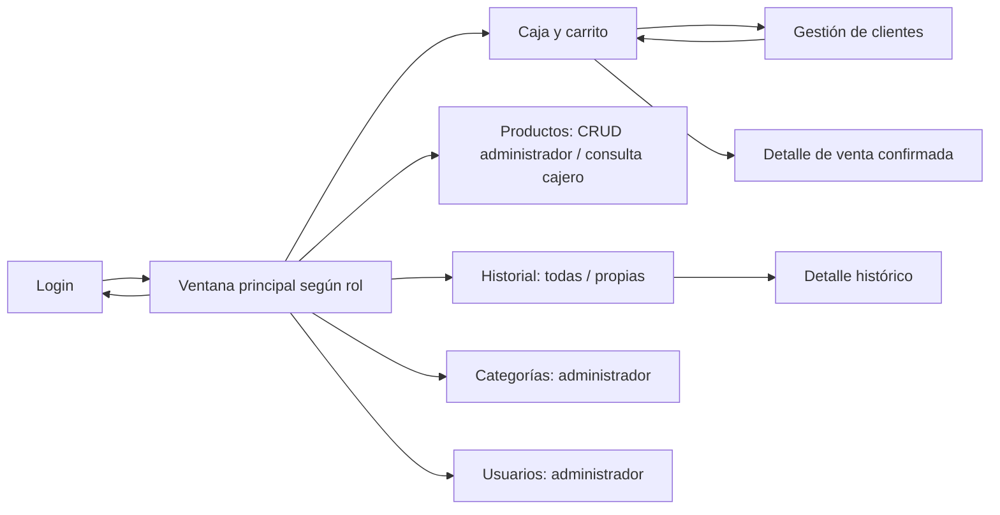

# Fase 3 — interfaz Swing y ejecución

## Qué se entrega
Aplicación de escritorio ejecutable con ventanas Java Swing y persistencia MySQL. Figma sería un prototipo opcional: no ejecuta el código Java ni reemplaza Swing. La consola de Fase 2 sigue disponible para estudiar lógica y diagnosticar; el inicio predeterminado del proyecto ahora es gráfico.

Las ventanas se construyen con código Java. NetBeans puede abrirlas, compilarlas y ejecutarlas; no se generan archivos .form ni dependen del diseñador visual del IDE.

## Pantallas y navegación


| Pantalla | Comportamiento |
|---|---|
| Login | Usuario/contraseña, Enter para ingresar, mensajes de acceso, creación de administrador inicial solo si la tabla está vacía. |
| Principal | Nombre y rol, navegación lateral y cierre de sesión. No muestra módulos administrativos al cajero. |
| Productos | Búsqueda por nombre/código, categoría, precios, stock, mínimo, vencimiento y alertas. Administrador crea/edita/elimina o desactiva. |
| Categorías | Alta, búsqueda, edición y borrado; la FK bloquea categorías con productos. |
| Caja | Búsqueda, cantidad, carrito agrupado, quitar/vaciar, selección de cliente y EFECTIVO/TARJETA, confirmación y detalle. |
| Historial | Intervalo de fechas inclusivo, tabla y detalle con precio cobrado. Administrador ve todas; cajero solo propias. |
| Usuarios | Alta, edición de rol/estado y contraseña opcional, eliminación/desactivación. Sin mostrar hashes. |
| Clientes desde Caja | Crear y editar para ambos roles; borrar solo administrador, sin ventas. Consumidor Final protegido. Volver a Caja conserva el carrito. |

No procesa pagos bancarios ni imprime facturas fiscales. El detalle de venta es una consulta de la operación, no una factura electrónica.

## Archivos exactos
Raíz Java: `src/main/java/com/progra/pos/view/swing/`.
- `SwingApp.java`: main y estilo Nimbus; inicia el hilo de eventos.
- `VentanaLogin.java`, `VentanaPrincipal.java`: ventanas y navegación.
- `PanelProductos.java`, `PanelCategorias.java`, `PanelUsuarios.java`, `PanelClientes.java`: pantallas de catálogo.
- `PanelCaja.java`, `PanelHistorial.java`, `DetalleVentaDialog.java`: flujo de venta y consulta.
- `Ui.java`: componentes comunes, presentación monetaria y mensajes.
- `Formulario.java`: editor modal que no cierra si sus campos son inválidos.
- `PanelListado.java`: estructura común de tablas, selección y CRUD.
- `TareasUi.java`: SwingWorker, estado y bloqueo temporal de acciones.

`nbactions.xml` configura Ejecutar en NetBeans; `pom.xml` define la ejecución escritorio en otra JVM. La aplicación de escritorio usa su propia JVM; la consola mantiene exec:java. El Login completa su primer dibujo al recibir windowOpened, también en una pantalla virtual.

Los controladores y DAO están en sus paquetes originales. La vista no contiene SQL ni abre conexiones.

## Ejecutar en NetBeans 31
1. Tener MySQL iniciado y haber importado `sql/01_schema.sql` en una BD vacía. Se conservan la conexión y los datos de Fase 2.
2. Configurar POS_DB_URL, POS_DB_USER y POS_DB_PASSWORD en el proceso que inicia NetBeans. Consultar `docs/fase2/ejecucion.md` para TLS y base de datos. No guardarlas en Git.
3. Abrir el proyecto Maven mediante pom.xml y seleccionar un JDK completo >=21; JDK25 es compatible.
4. Clean and Build. Pulsar Ejecutar proyecto: `nbactions.xml` selecciona `process-classes exec:exec@escritorio`, con `com.progra.pos.view.swing.SwingApp` en una JVM independiente. En terminal: `mvn compile exec:exec@escritorio`.
5. Si NetBeans conserva una acción de ejecución personalizada anterior, restablecerla para usar nbactions.xml o ejecutar directamente el método main de SwingApp.
6. En una primera instalación sin usuarios, pulsar “Crear administrador inicial” en Login y elegir credenciales propias. Si ya hay usuarios, ingresar con una cuenta existente: no hay restablecimiento de contraseñas desde ese botón.
7. Crear categorías/productos y un cajero desde sus pantallas. Cerrar sesión para probar el menú del cajero.

Se requiere una sesión gráfica del escritorio. La nube no publica una vista web de Swing ni un enlace localhost.

## Alternativa Linux/Docker
```bash
scripts/mysql-local.sh
scripts/swing.sh
```
JDK completo, Docker, curl y Python >=3.12 son requisitos de los scripts. Ingresar con credenciales existentes o crear administrador desde Login. Si se ejecuta en una terminal sin pantalla, abrir NetBeans en el escritorio para usar Swing.

Para la consola de Fase 2: `scripts/run.sh`; para su creación inicial por terminal: `scripts/run.sh -Dexec.args=--crear-admin`. Sin scripts, seleccionar la consola explícitamente: `mvn compile exec:java -Dpos.mainClass=com.progra.pos.view.ConsolaApp`.

## Decisiones que debes explicar
- Cada llamada que llega a JDBC se ejecuta con SwingWorker.doInBackground; done actualiza componentes en el hilo gráfico. Las operaciones de una ventana se serializan y los controles se deshabilitan mientras trabajan.
- Las tablas no admiten editar celdas directamente: los formularios validan primero. Al ordenar una tabla, se convierte el índice visible al índice del modelo para editar/eliminar el registro correcto.
- El total de Caja es estimado. La confirmación acepta precios vigentes y vuelve a validar existencias en la transacción original.
- Si el stock cambia mientras se edita un producto, el UPDATE optimista rechaza guardar una copia antigua. Actualizar la tabla y editar nuevamente; no se restauran por accidente unidades ya vendidas.
- Si una venta confirma pero después falla actualizar la pantalla, no se repite la venta: consultar Historial. Si se pierde conexión durante commit, comprobar Historial antes de reintentar.
- La sesión vuelve a comprobar permisos en cada acción del controlador; ocultar botones no es la autorización.
- Cerrar sesión o ventana con carrito exige confirmar que se descarta. El carrito se mantiene al cambiar de módulo, pero no se guarda entre sesiones.

## Para la defensa
**Explicación:** Swing proporciona ventanas y eventos. El botón solicita una operación al controlador; SwingWorker permite que MySQL tarde sin congelar la ventana.

1. **¿Por qué SwingWorker?** Swing tiene un hilo de eventos. JDBC y BCrypt pueden tardar; ejecutarlos allí bloquearía clics y repintados. doInBackground trabaja fuera y done vuelve al hilo de eventos.
2. **¿NetBeans exige diseñar primero en Figma?** No. NetBeans es el IDE y Swing la biblioteca de componentes. Figma solo serviría para un diseño previo opcional.
3. **¿Por qué no SQL dentro de ActionListener?** Mezclaría presentación y persistencia, duplicaría validaciones y haría más difícil probar/reutilizar la lógica.

**Cambio en vivo: agregar una columna “Stock mínimo” a Caja.** 1) Abrir PanelCaja.java. 2) Añadir el encabezado después de Stock en productosModelo. 3) Añadir p.getStockMinimo() en la misma posición de cada fila. 4) Compilar. 5) Comparar los valores con Productos; no cambiar controller ni SQL porque el atributo ya existe.
